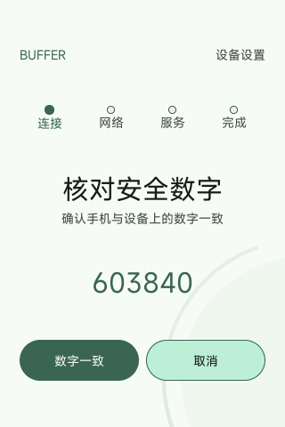
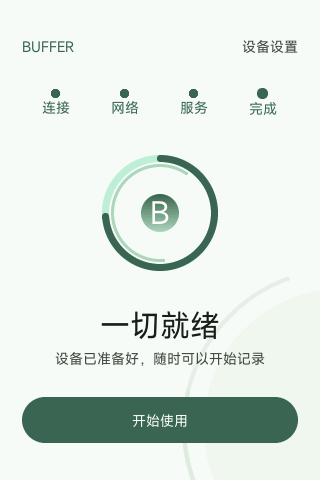

# OOBE 完成条件与界面验收

日期：2026-10-18。本页记录本轮修正与验收；未执行的项目明确保留待验证。

首次引导必须是独立全屏流程。配对、联网和模型服务验证完成后，设备展示“开始使用”，用户确认且完成记录成功落盘，才进入首页。模型 `ready` 只表示服务就绪，不再等同于引导完成；旧的“稍后配置”记录不能放行。

完成状态绑定当前设备身份及配对关系。已完成设备普通断网仍可使用本地能力，不因网络波动重新进入首次引导。绑定记录损坏或换绑不得沿用不匹配的完成记录。

| 情景 | 必须满足的行为 | 本轮结果 |
| --- | --- | --- |
| 全新设备 | 全屏欢迎/手机连接入口，二维码可读；没有录音、卡片操作或助手入口，也没有跳过按钮 | Windows 独立新磁盘 320×480 通过；实际完整截图经 ZXing 解码成功 |
| 旧版“稍后配置” | 升级后仍须完成引导，不能绕过 | 主机状态测试通过；新实例写入 `deferred=1` 后重启仍为欢迎页 |
| 已配对但未联网或未验证模型 | 留在对应引导步骤，保留已完成步骤，不重新配对 | 新实例双端 SAS 一致确认后进入网络引导；经已保存的手机服务配置验证后进入 READY |
| 服务已就绪 | 显示准备完成页面，点击“开始使用”前不能进入首页 | 原 Windows 实例保留数据升级后停留“一切就绪”；状态测试通过 |
| 保存完成记录失败 | 留在引导中，给出可重试提示，不开放业务操作 | 生产存储函数故障注入与状态测试通过；未对运行实例制造磁盘故障 |
| 未完成时触摸旧录音区域 | 不录音，不触发隐藏页面或助手工具 | 新实例实际触摸原底部录音区域后队列仍为空；主程序录音入口另有完成状态检查 |
| 完成并重启 | 保留完成状态及原卡片；临时离线不重复首次引导 | 新实例点击完成后重启仍为主页，5 张同步卡片保留；执行 `ifdown eth0` 后仍为主页，离线状态逻辑测试通过 |
| 手机收到模型 ready 回执 | 等待设备完成确认；只有 `capabilities.setup_complete=true` 才显示设置完成 | 实际先显示“服务已验证，请在 Vela 上点击开始使用”，设备点击后显示“设备设置已完成”；292 项 Android 单元测试、assemble、lint 通过 |

视觉验收覆盖 Windows 可见 Vela 320×480，关注欢迎、数字核对、联网/服务配置和准备完成页面。保持原绿色主题，减少长段状态文本，明确每屏的主操作，避免按钮挤压和触摸穿透。原运行实例的数据盘、身份、配对和凭据保留；首次开机使用独立新磁盘验证。

本轮实际页面（Windows 原生模拟器，未经 UI 合成）：

| 欢迎（320×480） | 数字核对（320×480） | 准备完成（320×480） | 欢迎（240×320） |
| --- | --- | --- | --- |
|  |  |  |  |

首次完整流程中发现并修复两项关联问题：

- 模拟器启用 `CONFIG_DEV_URANDOM_CONGRUENTIAL`，旧代码读取 `/dev/urandom`，导致独立新盘生成重复 Fabric 身份。Fabric 身份/握手、TLS 和 coordinator incarnation 改用共同的强随机读取入口；NuttX 使用硬件 `/dev/random`，无硬件 RNG 时失败关闭，Linux 测试仍使用系统 CSPRNG。实际新建身份已确认不同，模型 TLS 验证通过。历史实例身份和绑定未自动轮换，本轮保留原数据。
- 首次配对后切换应用 Session 遇到断线时，新设备尚无 `Active` 路由，重试无法恢复。现在 Hub 报告 `Paired` 且身份检查通过后即保存该设备的非权威发现提示，后续重试仍指向当前设备；失败不会默默改连旧设备。首次完整流程实际验证时该断线经手动重连恢复；修正后的自动重试通过构建和源码复核，尚未重做无线首次配对故障注入。

生产存储/协议、Fabric admission、coordinator、强随机接口及实际 mbedTLS HTTPS 回归通过。上述无线验证使用 Windows 模拟器；Gemini S1 实机 Wi-Fi、相机扫码及硬件音频不属于本轮已验收结果。
