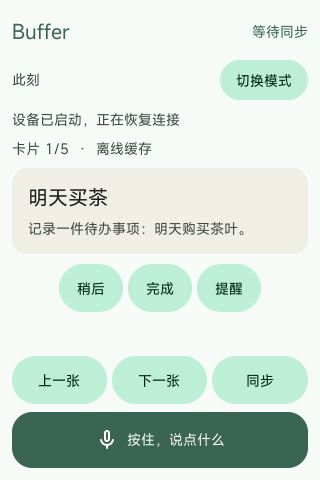
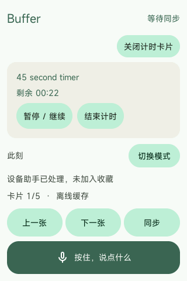
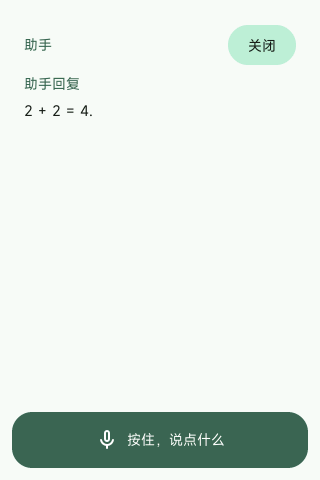

# 单一入口与自动意图判断

日期：2026-10-18。Vela 保留一个按住录音入口，移除“记录 / 助手”选择及其状态。转写之后，由 Agent 理解完整输入并决定如何处理，不使用关键词规则分流。

## 使用行为

- 灵感、日记、需要保存的待办和留待研究的问题，进入 Buffer 分类、旧记录关联与卡片生成。
- 此刻要求执行的倒计时、闹钟、翻译、菜谱或直接问答，交给 Vela 助手的受限工具；不生成收藏卡片。
- 提到“计时器设计”不等于要求启动计时器。缺少必要参数时，助手可以澄清，不能编造执行参数或声称操作成功。

记录入口、助手执行和 OOBE 完成门禁保持独立：必须先完成设备设置，才开放采集与用户任务处理。

## 跨设备执行

具备资格的手机仍优先成为 coordinator，负责 Vela 输入的转写与分类。手机 Agent 可以调用 `route_to_device_assistant`，将原始转写交给已经认证的 Vela，由设备执行本地助手能力；交接不再次转写音频。手机离线且 Vela 网络、模型和存储可用时，Vela 自己完成自动意图判断。

Android 的当前实现以手机和配对 Vela 为应用任务 membership，并以 Fabric 身份匹配源设备。任务受当前 coordinator term/lease 保护；等待模型或蓝牙时不持有 Repository/election 锁。明确断链使旧任务 lease 失效。这里的 term 是 Buffer 应用任期，不是 Fabric Session epoch。

新录音写入 `target=auto`。旧 `target=buffer` 及缺省 target 保持原来的记录语义；旧 `target=assistant` 保持设备助手语义。raw-input 分片新增可选 `target`，Android 只接受 `auto` 或 `buffer`，缺省按 `buffer` 解释，分片拼装及重复导入都检查 target 一致性。只有 `auto` 输入向手机模型开放助手交接。

自动输入在转写、意图判断完成前保持隐藏占位项，不进入收藏和设备卡片副本。记录分支完成后才发布分类卡片；助手交接成功后移除未被用户修改的占位项，并保留原 capture 与转写供恢复。普通卡片编辑和删除入口拒绝操作未完成的占位项。

## 交接协议

请求通过 Fabric 认证应用消息发送：

```json
{
  "type": "vela.capture.assistant.request",
  "protocol": 1,
  "request_id": "32位小写十六进制",
  "capture_id": "原采集ID",
  "record_sha256": "原始输入的SHA-256",
  "transcript": "完整转写文本",
  "coordinator_term": 7
}
```

`request_id` 为 `SHA-256(capture_id + NUL + record_sha256 + NUL + transcript)` 的前 32 个十六进制字符；同一请求跨重发、跨任期保持稳定。单帧最多 12 KiB，转写最多 4000 字符且 UTF-8 不超过 8192 字节。

Vela 检查 OOBE 完成状态、当前 Fabric 绑定、实时应用授权、手机 coordinator 身份与任期，以及原输入哈希。原子保存助手归属、转写和 `handoff_source_sha256` 后才返回 `accepted`。回复类型为 `vela.capture.assistant.reply`，回显请求 ID、capture ID、原哈希和 `coordinator_term`，状态为 `accepted`、`duplicate`、`conflict` 或 `failed`。Android 忽略旧请求/旧任期的迟到回复，并验证其余关联字段。

`accepted` 只表示设备已持久接管，不能据此宣称倒计时等操作已执行。实际工具成功必须有设备执行回执。Android 最多等待 25 秒，每 3 秒重发；断线、超时或拒绝会保留源内容。

## 重试与去重

手机在发送交接前持久记录 `assistant_selected`。丢失回执后继续同一交接，不重新请模型把它改成记录。最终数据库提交仍须通过当前任务 fence，旧 worker 不能清除新 worker 的请求。

Vela 本机自动判断选择助手时，在执行工具前持久保存助手归属及 `intent_source_sha256` / `intent_text_sha256`。设备已执行后手机恢复协调，也能识别同一原始输入为 `duplicate`，不再次执行或改写原转写。远端交接的重复请求还须匹配已有交接内容。

助手工具继续使用稳定 operation ID 和持久执行 checkpoint。原始音频不会因为手机“已导入”或“已受理”而删除；Buffer 记录等待对应处理结果副本落盘，助手输入等待设备处理完成。

## 本轮验证

Android 298 项单元测试、assemble 和 lint 通过。助手全屏页为统一录音按钮保留完整区域，不依赖重叠图层的绘制顺序。测试包含模型函数调用分流、旧 target 兼容、重放 target 冲突、回执任期匹配、丢失回执后的固定意图恢复、错误 peer 拒绝及任务 fence。Native 完整构建通过；实际 SDK mbedTLS HTTPS 回归，以及 capture target、coordinator、队列公平和 Fabric admission 检查通过。

Windows 原生模拟器实际验证使用公开合成文本，经统一输入管线执行；没有使用私人录音或修改原设备绑定。

| 输入/场景 | 结果 |
| --- | --- |
| `Please start a 45 second timer.` | 手机 coordinator 自动选择助手交接；Vela `device_timer` 成功，记录为 `assistant_complete`；手机任务完成，收藏卡片数为 0 |
| `Note a tree timer design.` | 手机自动归类为 `spark_card`，仅生成 1 张“树形计时器设计想法”卡片；设备收到已处理副本后原记录变为 `phone_complete`，未新建计时器 |
| 手机断开后 Vela 本机自动问答 | `connected=0, active=0, local=1` 时输入 `What is the capital of France?`；本机选择 `show_answer` 并显示 Paris，记录为 `assistant_complete`，无 `segments` 卡片 |

本轮文本注入用于隔离验证转写后的意图处理。真实麦克风采集、Gemini S1 实机 RF/Wi-Fi、闹钟声音和深睡唤醒不属于本轮新增验收结果；ASR 协议及转写后处理使用生产代码的 HTTPS fixture 覆盖。


实际界面：

| 统一输入 | 自动执行计时器 | 本机问答与完整录音入口 |
| --- | --- | --- |
|  |  |  |

最终固件已安装到原 Windows Vela 实例，保留原数据盘、身份、配对和卡片。Android 使用原 R7 AVD 数据；测试副本单独运行，验收后关闭。最终 ELF SHA-256：`5d2d6512cd1196a6bbca1ca30bf1da089b84484864779ba970a98b19663b97e2`。
