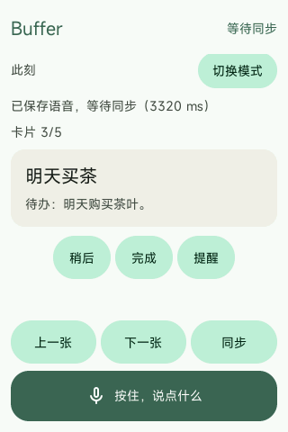
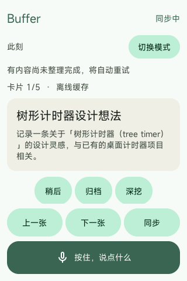
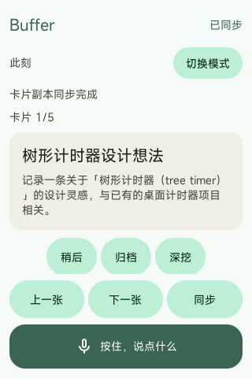

# 双端同步状态与手动核对

## 本次定位

2026-10-18 在 Windows Android 17 模拟器与原始 Vela 模拟器上检查：Fabric 安全会话已激活，协调者为手机，但 Vela 顶部仍显示“等待同步”。原因是界面读取旧局域网同步线程的 `phone_synced`；Fabric 绑定后该线程不会执行旧协议，因此这个值不能表示蓝牙应用消息的状态。旧“同步”按钮也只唤醒局域网线程。

现场核对手机 17 张卡片，其中两张待转写不应进入设备卡片副本；Vela 有其余卡片与删除标记共 16 份副本。通过 Vela 提交公开测试文本 `sy1537`，手机完成分类生成一张卡片，设备收到处理后的副本并把输入标记为 `phone_complete`。这证明当时数据通路可用，状态提示和手动同步入口需要修复。

最初两条待转写录音的时长分别为 120 和 320 毫秒；排查期间另有 1720 和 3320 毫秒录音进入手机。检查这四份已接收 WAV 的采样统计，峰值、RMS、非零样本数均为零，因此 ASR 无法转写，并非蓝牙未送达。仅检查波形统计，不转储录音内容到报告；原文件全部保留。

Windows 启动脚本通过控制台 `avd hostmicon` 启用宿主麦克风。2026-10-19 实机操作模拟器复测发现，保留 `-no-audio` 时，重新启用麦克风后录制的 5120 毫秒 WAV 仍全部为零。移除该参数，保留显式 `virtio-snd` / `-allow-host-audio`，重启同一数据盘后，新录制的 2920 毫秒 WAV 峰值为 3869，手机接收后实际转写得到“设置一个三十秒计时器。”。此证据确认该次录音、蓝牙传输和 ASR 转写链路通过，不代表后续 Agent 工具执行已通过；旧静音录音不能自动恢复。

## 应用协议

沿当前经过认证的 Fabric 会话发送，不重新配对或重连：

```json
{"type":"buffer.sync.request","protocol":1,"request_id":"00000000000000000000000000000001"}
```

手机保留正在传输的分片，随后从头核对全部卡片及删除标记。只有扫描结束且每份卡片收到设备保存回执后才发送：

```json
{"type":"buffer.sync.reply","protocol":1,"request_id":"00000000000000000000000000000001","state":"complete"}
```

如设备保留较新的版本或删除状态，结果为 `conflict`，不宣称已完全一致。同一个请求重试不会重置进行中的扫描；已完成的请求重试会重新发送完成回执。新请求重新核对副本。设备只接受当前认证会话与请求对应的结果，断开后不能沿用旧会话的完成状态。

“已连接”只表示安全会话可用；“同步中”表示核对尚未完成；“同步完成”只用于收到完整核对回执的请求。待转写和待分类工作有独立的处理状态，不能因卡片副本核对完成而视作已完成语音处理。Vela 首页仍自行选择最多五张卡片，完整副本不局限于首页展示数量。

## 验证

Android：301 项单元测试通过，构建和 lint 通过。新增测试覆盖完成回执必须等待所有分片保存、同请求重试不重置、队列忙时重试完成回执、传输中发起核对不丢分片，以及较新设备版本返回冲突。

原始 Windows 两端保留数据更新后，实际点击 Vela“同步”，先显示“同步中”，约一分钟后收到完整核对回执，显示“已同步 / 卡片副本同步完成”。此外在 Vela 归档本次合成测试卡片 `sy1537`，手机对应卡片状态更新为 `archived`，验证了设备操作返回手机的路径。

重启后的卡片内容完全相同时，原先 `cards_stale` 不会被清除；现在仅在收到当前会话完整同步回执后清除这一缓存标记，不修改旧 LAN 协议的 `phone_synced`。新同步协议主机回归与 Fabric 接入回归均通过。

最终原机固件 SHA256：`71e101de5cbaad20e34bc5909cdcb2e7c1ba1694b0b43d51356f9c767ee23f87`。


最终固件再次重启并完成全量核对后，实测“离线缓存”标记已消失；Fabric 会话 `connected=1, active=1`，协调者为手机。两台原始 Windows 模拟器保持运行。




