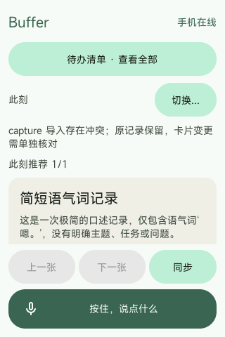
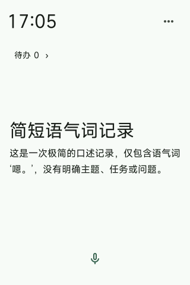
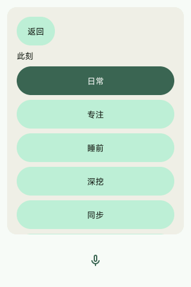
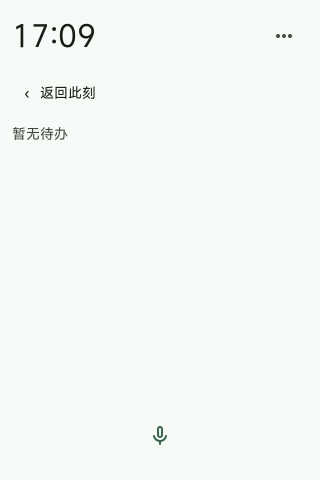

# Vela 首页精简与运行验收

2026-10-19，Windows Vela 模拟器，320 × 480。保留现有配对、服务配置、录音和卡片数据；Android 模拟器保持运行。

## 已完成

- 顶栏改为时间、必要异常提示和 Material 更多图标；正常连接不常驻状态文字。
- 移除首页流水状态、教学文字、推荐计数和空卡片。零卡或单卡时不显示分页。
- 卡片以标题与正文为主，点击后进入详情和操作；模式、同步、诊断移入更多菜单。
- 待办使用紧凑文字入口，保留 48 px 点击高度。列表与首页内容互斥显示。
- 底部固定 Material 麦克风，按住后才出现录音时长和取消提示。
- 助手结果进入独立页面，后台结果提示占用预留区域，不新增首页内容行。
- 修正短按钮默认内边距导致的竖排问题；文字限定单行，更多入口使用真实图像资源。
- Windows 启动时向 guest 应用传入宿主当前时区偏移，避免新首页时钟直接显示 UTC。偏移在启动时计算，跨夏令时切换仍需重新启动以刷新。

## 验证

`python3 -m pytest tests/test_ui_motion.py tests/test_capture_target.py tests/test_todo_list.py -q`：3 项通过。覆盖真实 LVGL 生命周期、独立回答页错误反馈、待办入口点击及返回、稳定行身份，以及录音取消和完整待办数据逻辑。该组测试不代替实际视觉检查。

Goldfish ARM64 完整构建通过。Windows 实际查看首页、点击更多、返回、打开待办和返回均正常；更多图标横排，返回按钮横排，底部麦克风保持固定。录音取消的本轮证据来自 host 回归测试，未新增用户语音录制。

固件 SHA256：`0ff6a30361b02899e70f8e3901f4d533151832f0ae124c26ecd8534926e95c08`。

| 修改前 | 修改后 |
|---|---|
|  |  |

更多菜单：

待办空状态：

## 本轮边界

没有删除或隐藏原有用户卡片。截图中的“简短语气词记录”属于既有模型分类结果，其语义丢弃策略需要单独修复，不能靠界面隐藏冒充解决。TTS、回答速度及跨端冲突管理不属于本轮首页精简的完成声明。独立文案审核记录见 `15-ui-copy-audit.md`。
