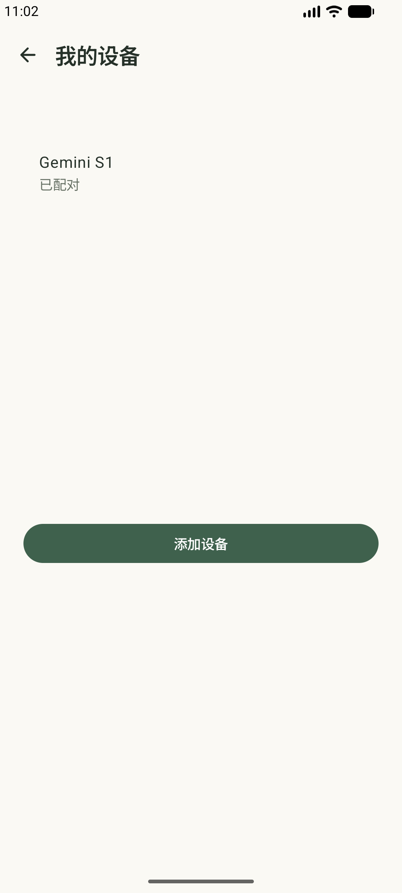
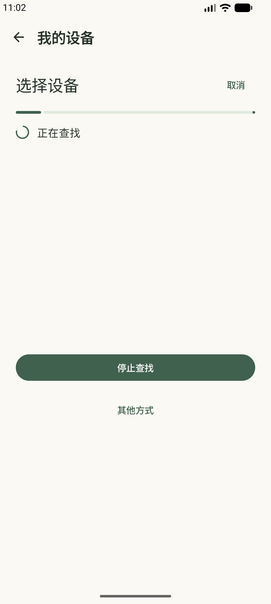
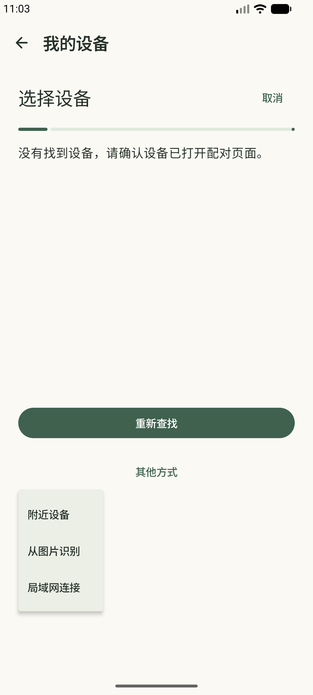
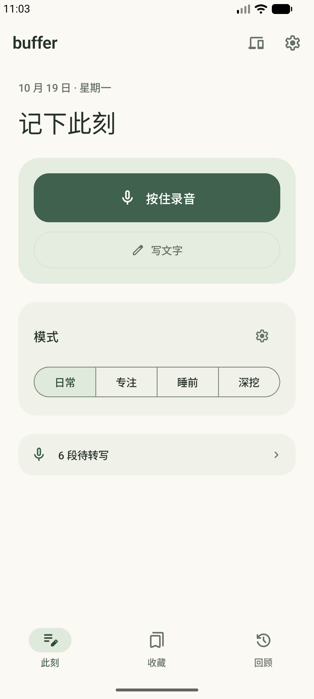

# 手机分步配对与文案集成

2026-10-19。已构建并安装到 Windows Android 17 模拟器 `emulator-5582`，保留原应用数据、密钥和配对。

## 页面组织

- 已有设备列表与添加流程分开；已有设备页只保留设备信息和添加入口。
- 添加流程依次显示设备发现、数字确认、网络选择、服务检查和完成；必要的设备端确认单独呈现。
- 设备以可选择列表行展示，统一使用一个主要操作；扫码、从图片识别及局域网连接放入“其他方式”，不再常驻展开。
- 内容区、反馈区和操作区保留固定布局槽位。普通传输状态不会插入额外按钮或覆盖数字确认。
- 新增配对以结构化步骤及数字字段驱动展示，未用自然语言状态文本推断配对阶段。
- 新配对必须选择网络；配对会话重连不会丢失这一要求。已完成绑定的普通重连仍使用已有网络。
- 手机仍须明确确认 SAS 数字，设备仍须确认；服务未验证或设备未确认完成，不展示完成状态。
- 待转写原件保留在队列，通过一个待转写入口访问；主页和收藏不再重复展示空的待转写卡片。

独立审核对其他页面做的纯文案修正见 `15-ui-copy-audit.md`。生成“语气词解释卡片”的语义问题未通过过滤用户卡片来掩盖。

## 验证

Android 单测 319 项通过，无失败或跳过；lintDebug 与 assembleDebug 通过。新增回归覆盖：数字确认不显示网络表单、普通连接进度不能覆盖待确认的 SAS、配对会话重连后保留网络选择步骤。

实际在 Windows 模拟器查看已有设备页、进入设备发现、展开其他方式、取消添加并返回首页。验证过程没有解除既有绑定或清空用户数据；因此本轮没有重新走一遍全新身份的实际双端首次配对，网络和数字确认阶段的新增证据来自上述回归测试。

APK SHA256：`2cccd168d8e05aa6b919041b8c8d0110052fd177a9fbba32190165d8e84f6f49`。

文案审核后的 Vela 固件 SHA256：`cb4a3d9caf5602a64d4c5caaa5056129c4768789584b0728a7da204d27145db6`。设备 3 项相关 host 测试及完整构建通过；运行时确认原绑定恢复、Agent ready、手机协调者恢复。

## 运行截图

| 已有设备 | 设备发现 |
|---|---|
|  |  |

其他方式：

首页：
